# Práctica: Desarrollo Interactivo de App (parte 3)

En esta práctica construí la misma aplicación pequeña, un directorio de usuarios, en dos frameworks distintos: React, que ya habíamos usado en el proyecto grupal, y Vue, que escogí como segundo framework para ver cómo se trabaja con otra herramienta.

## Datos generales

- **Estudiante:** Cristina Loja
- **Datos usados:** API pública https://jsonplaceholder.typicode.com/users. Solo se consulta, no fue necesario levantar ningún servidor.


## Estructura del repositorio

```
practica-desarrollo-interactivo/
├── README.md
├── react-app/
│   └── evidencias/
└── vue-app/
    └── evidencias/
```

Cada framework tiene su propia carpeta con su proyecto y con las capturas que demuestran que funciona.

## Qué hace cada aplicación

Las dos apps hacen exactamente lo mismo, para poder compararlas:

- **Instalación:** cada proyecto se creó con Vite y se comprobó que corre con `npm run dev`.
- **Datos:** al abrir la página se piden los usuarios a la API con `fetch`. Se revisa que la respuesta sea correcta (`response.ok`), se muestra el mensaje "Cargando..." mientras se espera y, si la API falla, aparece un mensaje de error.
- **Componentes:** cada usuario se muestra en una tarjeta (`UserCard`) con su nombre, correo y ciudad. La tarjeta es un componente reutilizable: recibe el usuario desde el componente padre y le avisa cuando se presiona el botón de favorito.
- **Estado:** hay un buscador que filtra por nombre mientras se escribe, un botón "Favorito" en cada tarjeta y un contador "Favoritos: N" que se actualiza al marcar o quitar favoritos.
- **Pruebas:** una prueba unitaria hecha con Vitest para la función `searchUsers`, que es la que filtra los usuarios por nombre.

## Cómo ejecutar cada app

Para correr cualquiera de las dos apps se necesita tener Node.js instalado.

### React

```bash
cd react-app
npm install
npm run dev
```

Después se abre http://localhost:5173 en el navegador 0 depende del puerto de su computadora. Para correr la prueba:

```bash
npm test
```

### Vue

```bash
cd vue-app
npm install
npm run dev
```

Después se abre http://localhost:5173 en el navegador 0 depende del puerto de su computadora. Para correr la prueba:

```bash
npm test
```

## Evidencias de funcionamiento

### Vue

**Instalación de Vitest.** Muestra que las dependencias de pruebas se instalaron sin problemas.

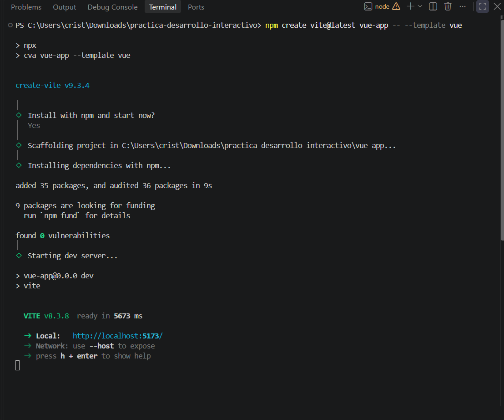

**App corriendo.** La aplicación cargando los usuarios desde la API.

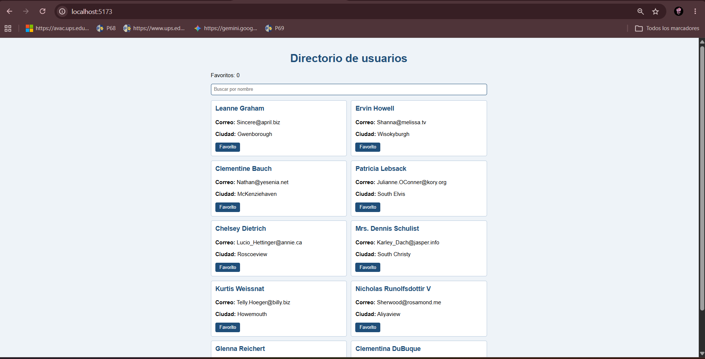

**Cargando...** El mensaje que aparece mientras se esperan los datos.

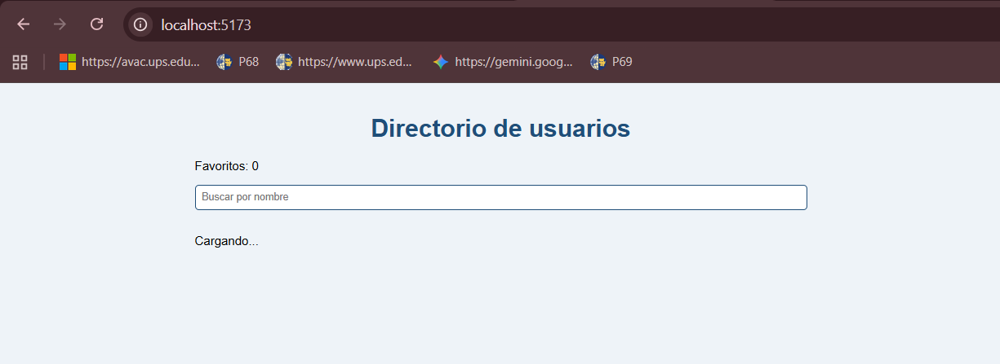

**Error de la API.** Para provocarlo cambié temporalmente la URL por una que no existe, y luego la devolví a la correcta.

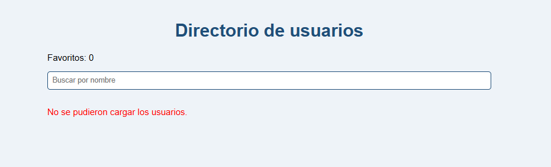

**Búsqueda.** La lista se filtra mientras se escribe en el buscador.

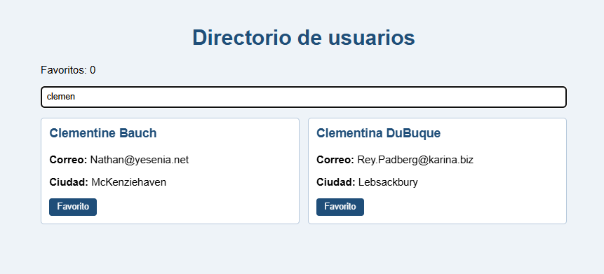

**Favoritos.** Tarjetas marcadas como favoritas y el contador actualizado.

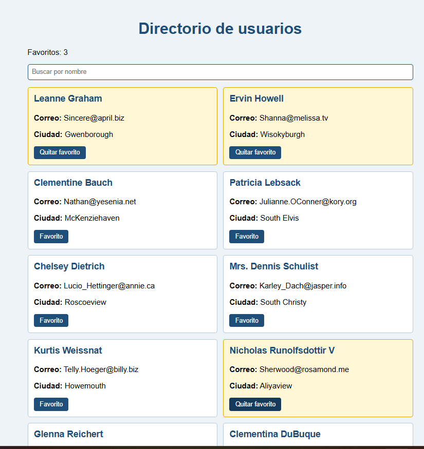

**Prueba unitaria.** La prueba de `searchUsers` pasando correctamente.

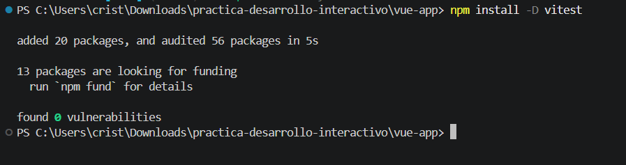

### React

**App corriendo.** La aplicación cargando los usuarios desde la API.

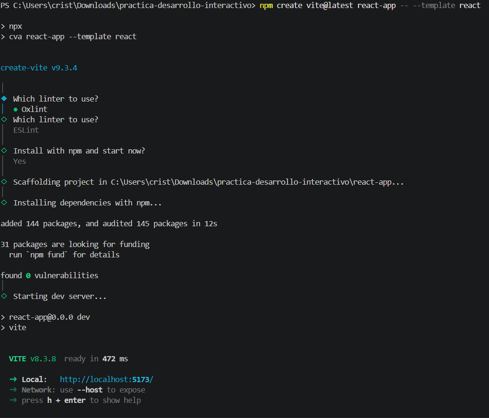

**Cargando...** El mensaje que aparece mientras se esperan los datos.

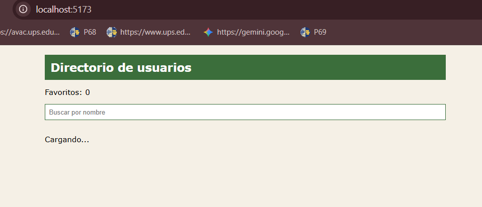

**Error de la API.** Provocado igual que en Vue, cambiando temporalmente la URL.

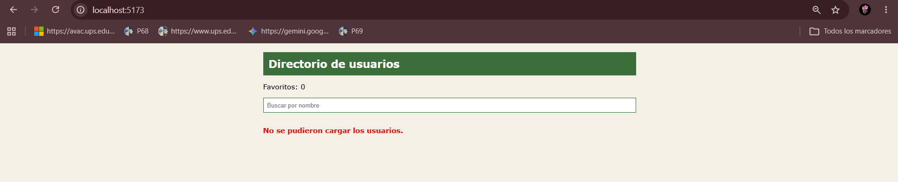

**Búsqueda.** La lista se filtra mientras se escribe en el buscador.

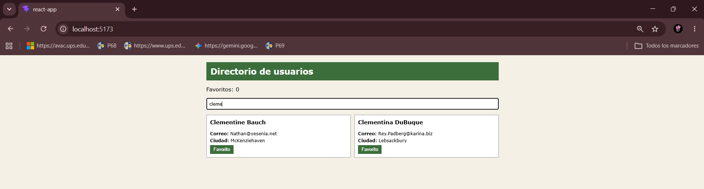

**Favoritos.** Tarjetas marcadas como favoritas y el contador actualizado.

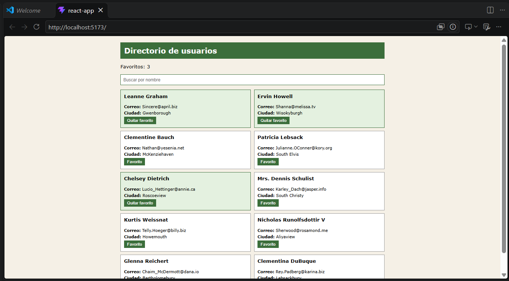

**Prueba unitaria.** La prueba de `searchUsers` pasando correctamente.

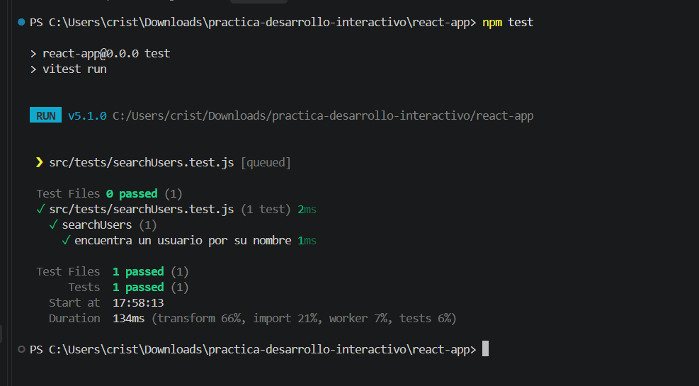

## Comparación entre React y Vue

Aunque las dos apps hacen lo mismo, la forma de escribirlas cambia en varios puntos:

| Qué se necesita | React | Vue |
|---|---|---|
| Guardar datos que cambian (estado) | `useState`, con una función para modificarlos | `ref`, que se modifica con `.value` |
| Lista filtrada por el buscador | Se calcula directamente al renderizar | Se usa `computed` |
| Cargar datos al iniciar la página | `useEffect` con `[]` | `onMounted` |
| Avisar al padre desde la tarjeta | Una función que llega por props | `defineEmits` y `emit` |
| Campo de búsqueda | `value` y `onChange` | `v-model` |
| Mostrar cosas según una condición | `&&` dentro del JSX | `v-if`, `v-else-if` y `v-else` |

## Mi experiencia

Me gustó más trabajar con React, sobre todo porque ya lo había usado en el proyecto grupal y me sentí más cómodo con `useState` y `useEffect`. Vue me pareció más fácil de leer, porque `v-model` y `computed` ahorran código en el buscador y en la lista filtrada. Lo que más me costó de Vue fue acostumbrarme a usar `.value` en los `ref` y entender cómo se comunica la tarjeta con el padre usando `emit`. En React, lo que más me costó fue entender cuándo se vuelve a renderizar un componente. Ambos frameworks sirven para aplicaciones con mucha interacción del usuario, como esta, donde cambian los datos, la búsqueda y los favoritos. Con esta práctica aprendí que la lógica de fondo es la misma en los dos y que lo que cambia es la forma de escribirla.
